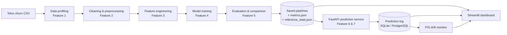

# Architecture

## Module map

| Path | Responsibility |
| --- | --- |
| `src/retainiq/config.py` | Paths, risk bands, `Settings` loaded from env |
| `src/retainiq/data/loader.py` | Feature 1: load CSV, profile rows/columns/missing/duplicates |
| `src/retainiq/data/quality.py` | Validation checks with severity levels |
| `src/retainiq/features/cleaning.py` | Feature 2: dtype fixes, de-duplication, imputation, target encoding |
| `src/retainiq/features/engineering.py` | Feature 3: tenure buckets, spend ratios, service counts, flags |
| `src/retainiq/features/pipeline.py` | Scikit-learn `ColumnTransformer` + `Pipeline` builders |
| `src/retainiq/features/fields.py` | API name <-> dataset column mapping |
| `src/retainiq/models/registry.py` | Feature 4: Logistic Regression, Random Forest, optional XGBoost |
| `src/retainiq/models/train.py` | Split, threshold tuning, CV, artifact persistence |
| `src/retainiq/models/evaluate.py` | Feature 5: metrics, confusion matrix, ROC/PR curves, comparison table |
| `src/retainiq/models/predictor.py` | Feature 6: probability, risk band, per-field explanations |
| `src/retainiq/monitoring/store.py` | Feature 7: SQLAlchemy prediction log and aggregates |
| `src/retainiq/monitoring/drift.py` | Feature 7: PSI per feature against training reference |
| `src/retainiq/api/main.py` | Feature 7: FastAPI routes with graceful degradation |
| `src/retainiq/dashboard/app.py` | Streamlit UI: overview, metrics, scoring, monitoring |
| `scripts/` | Download, train, generate demo traffic |
| `tests/` | 60+ unit and API tests on synthetic data |

## Key design decisions

1. **Preprocessing lives inside the exported pipeline.** The API receives raw
   strings and never re-implements encoding. This eliminates training/serving
   skew, the most common cause of "it worked in the notebook" failures.
2. **Three-way split.** Train -> choose threshold on validation -> refit on
   train + validation -> report on an untouched test set. Reporting a threshold
   tuned on the test set would be leakage.
3. **Threshold is a product decision, not a default.** 0.5 is arbitrary for an
   imbalanced problem. The F1-optimal threshold is stored with the model and
   surfaced in the API response.
4. **Model-agnostic explanations.** Instead of depending on SHAP, each field is
   reset to the typical customer and the probability delta is measured. Slower
   than reading linear coefficients, but it works identically for forests and
   boosted trees, and is cheap at one row per request.
5. **Monitoring separates input drift from performance drift.** PSI is computed
   on every request's payload against the training distribution. Accuracy drift
   requires labelled outcomes and is documented as a follow-up.
6. **SQLite by default, PostgreSQL by configuration.** One environment variable
   changes the persistence layer; the repository layer is SQLAlchemy so no code
   changes are needed.

## Failure modes handled

| Failure | Behaviour |
| --- | --- |
| Dataset missing | Downloader prints an actionable error; API still boots |
| Model missing | `/health` returns `degraded`, `/predict` returns 503 with the train command |
| Database unavailable | `/health` reports `unavailable`; prediction still succeeds |
| Unknown category at inference | `OneHotEncoder(handle_unknown="ignore")` |
| Missing customer fields | Filled with training-time median / mode |
| Fewer than 20 live samples | Drift returns `insufficient_data` instead of noisy PSI |
